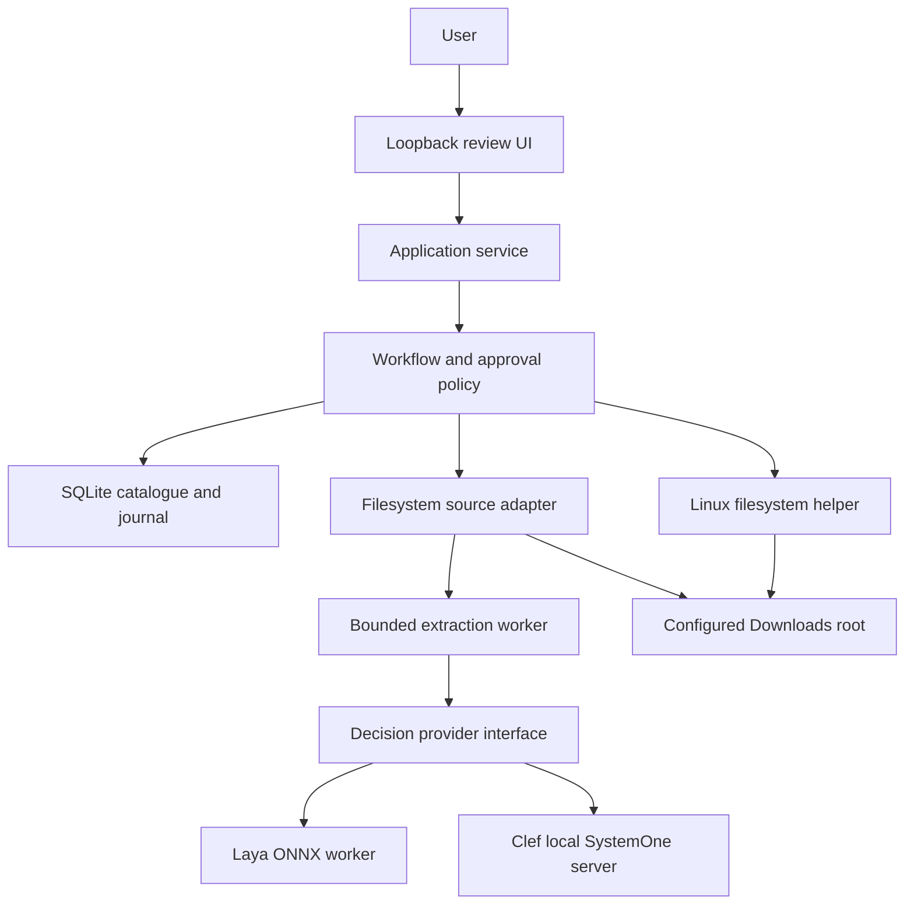
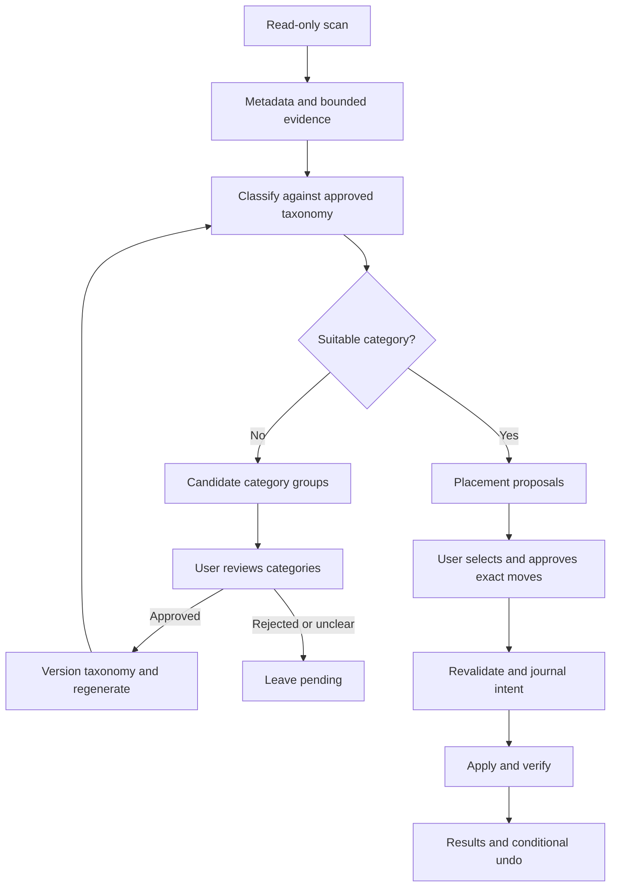

# Architecture and high-level design

Version 1.0 · 2026-10-06 · Implements the scope in [PRD](01-PRD.md).

## 1. Architectural choice

Use a modular local application. Domain logic owns taxonomy, decisions, approvals and workflow. Adapters own source-specific reads and mutations. Persistence is accessed through repository contracts. Presentation uses the application service. Decision providers never receive filesystem write authority.

Separate scripts would repeat review/recovery logic. A general tool-using agent would enlarge the action space and make evaluation less reproducible. Microservices would add operational work without helping this single-laptop pilot.

## 2. Deployment and trust boundaries

The inference worker and extraction process are isolated from the executor's capabilities. Local HTTP is a service boundary, not proof of trust: bind to `127.0.0.1`, authenticate sessions, validate origins and reject cross-site mutations. Build UI assets into the local server; Vite is development-only. SQLite/evidence directories use owner-only permissions and sit outside the organisation root.

The filesystem helper is a small Rust executable invoked with bounded JSON over stdin, argument-array spawning and a request ID. This is a justified addition to the TypeScript stack: Node's ordinary rename does not offer Linux `RENAME_NOREPLACE` semantics. The helper owns anchored path resolution and no-overwrite operations; business policy and journalling remain in TypeScript. Source [S4] in the source register grounds the syscall choice.

## 3. Dataflow and review boundaries

Category approval adds a logical destination mapping, not an immediate directory. Accepted execution may create its directory after preconditions pass. Created directories are journalled. Undo does not automatically remove empty directories in v1.

## 4. Taxonomy that fits small decision models

Represent categories as an approved tree with immutable IDs. Existing filesystem paths are leaf destinations; internal nodes can be virtual groups and need not create physical folders. Each node has up to seven children plus unknown. A path takes at most four decisions. A taxonomy exceeding those limits requires the user to group or reduce active destinations; no silent truncation or automatic candidate shortlist.

Example: a virtual `Learning` node routes to `AWS`, `AI`, or `Architecture`, each mapped to an existing Downloads folder. The folder tree can differ from the semantic tree. Add starter vocabulary destinations such as `Installers`, `Career`, or `Learning` only as reviewed candidates. Existing destinations take precedence when their approved meaning matches. Ambiguous existing meanings are resolved in taxonomy review.

The Laya SDK documents an English-state limit and a separate options-header limit [S1]. Construct a shared compact evidence record that fits all participating tokenizers and full request templates. Enforce limits before calls; record the exact evidence and schema hashes. Longer-context experiments use a separately named treatment, not the primary matched-input comparison.

Probabilities are recorded at each visited node. Do not multiply them into a supposedly calibrated global folder confidence. Any unknown answer or uncertain route can defer the item. Default mode presents all supported results for user review and exposes uncertainty without authorising moves.

## 5. New-folder proposals without a generative model

Classify against approved folder meanings first. For unknown items, score a finite user-editable starter vocabulary in small groups. Group items sharing a selected vocabulary label; suggest a folder only for at least three items or on explicit user request. These are category candidates, not guaranteed novel topics. Labels without vocabulary coverage remain pending so the user can name a category. Do not infer a free-form explanation or folder name from typed decision output.

Folder review can accept a candidate, rename it or map it to an existing destination. Increment taxonomy revision and regenerate affected decisions before placement approval. A new folder is one path segment below an approved existing directory; an explicit user-reviewed sequence is required for multiple new levels.

## 6. Persistence and workflow

SQLite stores batches, item snapshots, evidence manifests, taxonomy revisions, decision runs, proposals, approvals, action attempts and overrides. Transactions are short. Configure foreign keys, WAL and synchronous FULL [S11]. A process-level lock enforces one writer per configured root. Read/model work can be interrupted; apply is serial.

Filesystem operations and SQLite cannot share one transaction. Use durable intent, kernel operation, verification and reconciliation. A interrupted batch is reconstructed from each action's source/target state. Conflicts remain visible; the system does not blindly retry a rename.

## 7. Extension strategy

| Extension | Reused components | New adapter responsibility |
| --- | --- | --- |
| Google Drive | Taxonomy, decisions, review, batch journal | Stable file IDs, revisions, permissions, parent changes and compensating recovery |
| GitHub stars | Catalogue, classification, search, evaluation | Read starred repositories; verify separate native-list capability before proposing writes |
| X saved material | Evidence, local collections, review | Import links/exports or authorised bookmark reads; verify account/API capabilities |
| MCP client | Application commands and policies | Narrow tool transport; no alternate executor |

Each source advertises supported actions and recovery semantics. A local-file move and a local collection tag are different action types. Future sources must not pretend all writes support filesystem-style atomicity or undo.

## 8. Observability and budgets

Emit `batch_id`, opaque `item_id`, stage, provider revision, elapsed milliseconds, input token count, extraction status, defer reason and attempt outcome. Raw contents, sensitive filenames and credentials are not telemetry defaults. Structured logs are sufficient for v1; define an optional OpenTelemetry exporter later without requiring a collector.

Use bounded extraction/inference, a 200-file batch, serial providers and per-item deadlines. Retain last-known provider health but do not keep both models resident by requirement. Log cold-load and warmed timings separately. Exact-item corrections are explicit configuration; broad learned rules and fine-tuning are later experiments.

## 9. Failure policy

| Failure | Behaviour |
| --- | --- |
| Extractor timeout, malformed or unsupported file | Metadata-only status or pending; no repeated unbounded attempts |
| Provider unavailable or invalid probabilities | One transient retry; then defer; no cloud fallback |
| Taxonomy/policy changed | Invalidate affected approvals/proposals |
| Source changed or target occupied | Conflict; user reviews a regenerated proposal |
| Cross-mount move or unsupported syscall | Defer; do not substitute overwrite-capable operations |
| Crash after intent or syscall | Reconcile locations and verified identities before continuing |
| Undo target changed or original occupied | Conflict; preserve both locations |

## 10. Threat and durability assumptions

Protect against untrusted document content, symlink/path escape, cross-site UI requests, accidental concurrent file changes, destination collisions and interrupted app execution. A malicious program already running as the same Linux user can alter the database, credentials or files; the app does not claim isolation from that actor. Kernel no-overwrite/anchored resolution are strong boundaries; source fingerprint validation and post-move reconciliation handle normal concurrent edits but cannot provide an atomic compare-inode-and-rename primitive. Power-loss durability depends on filesystem/storage semantics despite directory fsync and SQLite FULL. Test and state these practical limits.

