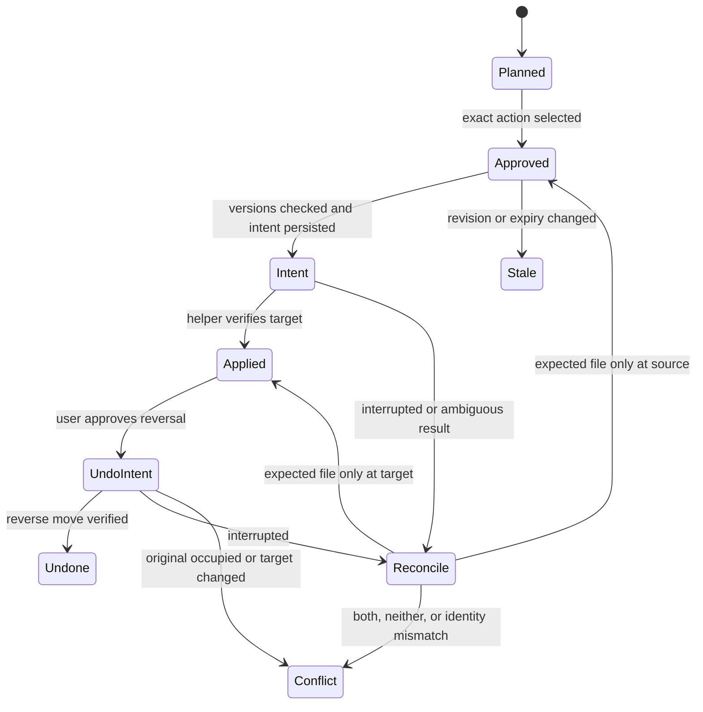

# Low-level design and implementation specification

Version 1.0 · 2026-10-06 · PRD IDs are authoritative. Proposed defaults are fixed for v1 unless changed with a decision entry.

## 1. Project structure

| Path | Responsibility |
| --- | --- |
| `src/domain/contracts.ts` | Normalised value types and result/error envelopes |
| `src/domain/taxonomy.ts` | Category validation and versioned mappings |
| `src/domain/planner.ts` | Convert decisions into logical proposals |
| `src/domain/policy.ts` | Eligibility, approval and action rules |
| `src/application/workflow.ts` | Batch orchestration, cancellation and stage progression |
| `src/application/recovery.ts` | Reconcile interrupted actions and undo |
| `src/adapters/filesystem/source.ts` | Scoped read-only discovery and stable snapshots |
| `src/adapters/filesystem/helper.ts` | Typed bridge to Linux helper |
| `src/adapters/extraction/extract.ts` | Bounded format handlers and worker limits |
| `src/adapters/providers/{rules,laya,clef,jev}.ts` | Provider-specific inference and normalisation |
| `src/adapters/persistence/{schema.sql,repositories.ts}` | SQLite schema and public repositories |
| `src/http/{server,routes,session}.ts` | Loopback API, validation and browser security |
| `src/cli/main.ts` | Explicit CLI verbs; same application service |
| `src/eval/{dataset,runner,metrics,report}.ts` | Frozen data, replay, scores and exports |
| `ui/src/{App,TaxonomyReview,PlacementReview,RunHistory}.tsx` | User review surfaces |
| `native/fsops/src/{main,resolve,operations}.rs` | Anchored Linux filesystem primitives |
| `tests/{unit,integration,e2e,fixtures}/` | Contract, recovery, UI and synthetic samples |

Node.js 22.18+ in the 22.x line; verify dependencies against the chosen patch and pin a lockfile. TypeScript strict; React + Vite UI; Fastify application API; better-sqlite3 repository; Vitest and Playwright checks; Rust stable edition 2024 helper on Fedora x86_64. Record exact resolved package, Cargo, model and runtime revisions in `docs/runtime-manifest.json` during implementation. No version is inferred from the user's current tools.

## 2. Core contracts

```typescript
type Id = string;
type Sha256 = string;
type Revision = number;
type ProviderId = 'rules' | 'laya' | 'clef' | 'jev';
type ErrorCode = 'OUT_OF_SCOPE' | 'UNSTABLE' | 'OVERSIZE' | 'UNSUPPORTED'
  | 'EXTRACTION_FAILED' | 'INPUT_TOO_LONG' | 'PROVIDER_FAILED'
  | 'INVALID_DECISION' | 'STALE' | 'COLLISION' | 'CROSS_MOUNT'
  | 'UNSUPPORTED_KERNEL' | 'CONFLICT' | 'UNAUTHORISED';
type Result<T> = {ok:true; value:T} | {ok:false; code:ErrorCode; detail:string};
interface Snapshot {
  device:string; inode:string; size:string; mtimeNs:string;
  ctimeNs:string; sha256:Sha256;
}
interface Item {
  id:Id; sourceId:Id; sourceKind:'filesystem' | 'collection';
  externalId:string; displayName:string; revision:string;
  snapshot:Snapshot | null; evidenceId:Id;
}
interface Evidence {
  id:Id; itemId:Id; profile:'metadata' | 'compact_text';
  state:Record<string,unknown>; stateHash:Sha256;
  status:'ready' | 'metadata_only' | 'failed'; truncated:boolean;
  extractorRevision:string; inputTokenCounts:Record<string,number>;
}
interface Category {
  id:Id; parentId:Id | null; label:string; description:string;
  destinationId:Id | null; kind:'group' | 'existing' | 'candidate';
}
interface ChoiceQuestion {
  id:Id; instruction:string; options:{id:Id; description:string}[];
}
interface DecisionRequest {
  evidence:Evidence; questions:ChoiceQuestion[]; schemaHash:Sha256;
  taxonomyRevision:Revision;
}
interface ChoiceAnswer {
  questionId:Id; selectedId:Id; probabilities:Record<Id,number>;
  providerConfidence:number | null;
}
interface Decision {
  id:Id; provider:ProviderId; modelRevision:string; runtimeRevision:string;
  evidenceHash:Sha256; schemaHash:Sha256; answers:ChoiceAnswer[];
  elapsedMs:number; tokenCounts:Record<string,number>; error:ErrorCode | null;
}
interface Proposal {
  id:Id; version:Revision; itemId:Id; categoryId:Id;
  destinationId:Id; basename:string; expected:Snapshot;
  taxonomyRevision:Revision; policyRevision:Revision;
  decisionIds:Id[]; state:'pending' | 'approved' | 'stale' | 'rejected';
}
interface Approval {
  id:Id; batchId:Id; actions:{proposalId:Id; version:Revision}[];
  actionSetHash:Sha256; taxonomyRevision:Revision; policyRevision:Revision;
  approvedAt:string; expiresAt:string; mode:'apply' | 'undo';
}
interface MoveReceipt {
  kind:'move_file'; actionId:Id; requestId:Id; outcome:'moved' | 'conflict' | 'unchanged';
  before:Snapshot; after:Snapshot | null;
  createdDirectoryIds:Id[]; verified:boolean;
}
interface SourceCapabilities {
  actions:('move_file' | 'tag_item')[];
  recovery:'reconcile_and_reverse' | 'compensate' | 'none';
}
interface ApprovedTag {
  kind:'tag_item'; actionId:Id; sourceId:Id; itemId:Id;
  expectedRevision:string; tags:string[]; approvalId:Id;
}
interface TagReceipt {
  kind:'tag_item'; actionId:Id; outcome:'tagged' | 'conflict' | 'unchanged';
  revision:string;
}
type ApprovedAction = ApprovedMove | ApprovedTag;
type ActionReceipt = MoveReceipt | TagReceipt;
interface SourceAdapter {
  capabilities():SourceCapabilities;
  discover(config:RootConfig):AsyncIterable<Result<Item>>;
  inspect(itemId:Id):Promise<Result<Snapshot>>;
  apply(action:ApprovedAction):Promise<Result<ActionReceipt>>;
}
interface DecisionProvider {
  health():Promise<Result<ProviderManifest>>;
  decide(request:DecisionRequest):Promise<Result<Decision>>;
  close():Promise<void>;
}
```

`RootConfig` contains opaque rootId, resolved absolute root, recorded device/inode, discovery depth 0, directory depth 3 and policyRevision. `ApprovedMove` contains kind `move_file`, actionId, rootId, source basename, approved destination relative segments, expected Snapshot and Approval ID. `ProviderManifest` records provider ID, pinned model/runtime/tokenizer revisions, question/input limits and actual endpoint. These value types live in contracts.ts. All integer stat values use decimal strings to avoid JavaScript precision loss. `externalId` is a source handle, never an unrestricted path supplied by the model. The action union reserves a non-filesystem extension shape; tag execution is disabled in v1. The mock second source advertises no actions and returns UNSUPPORTED on apply.

## 3. Provider normalisation and input budgets

The v1 provider API supports choice only. Translate the canonical question to SDK/SystemOne syntax inside adapters. For each answer require exact question IDs and option IDs, finite values in [0,1], probability sum within 0.001 of one, and selected ID equal to a maximum-probability option. Ties use lexical category ID order; preserve raw selected ID for diagnostics. Rules produce a degenerate distribution and are marked deterministic, not statistically calibrated. Reject unexpected fields rather than exposing provider output as actions.

Shared evidence includes basename, detected format, size and compact extracted text. Absolute path and atime are omitted. Cap compact text initially at 1,200 Unicode characters; shorten it further until the exact encoded request fits every provider in the comparison. Fit the Laya English checkpoint's full state/question budget and options header; use its tokenizer/config rather than assuming characters equal tokens. Questions have at most seven children plus unknown, and option descriptions at most twelve tokenizer tokens; validate the combined header too. If the template cannot fit even metadata, return INPUT_TOO_LONG. Record clipping and exact request hashes. Disable SDK silent truncation as an accepted behaviour: verify encoding or reject before invocation.

A taxonomy route calls one question per level, at most four. The decision path is retained. Default review_all defers explicit unknown and failed requests; low top probability is displayed as uncertain. Optional selective-review experiments use per-node thresholds fitted on calibration data, not a fixed guessed confidence such as 0.9. A path's acceptance requires each node's threshold and unknown rejection. Do not treat probabilities as authority.

Clef adapter sends `POST /v1/systemone` to an explicitly configured loopback endpoint and validates typed responses. Verify endpoint/model revision with a synthetic invoice/category fixture before loading private evidence. Jev adapter is disabled unless the dataset's explicit cloud consent is recorded; its endpoint is configured from official docs, not guessed. Local comparison serialises model loading. Health failure blocks that provider's evaluation, without silently dropping it from reported results.

## 4. Persistence and consistency

| Table | Essential columns and constraints |
| --- | --- |
| `roots` | id PK, canonical path, device/inode, policy revision |
| `batches` | id PK, root FK, stage, created_at, cancellation_requested |
| `items` | id PK, root FK, external_id, revision, snapshot_json, UNIQUE(root, external_id, revision) |
| `evidence` | id PK, item FK, state_hash, profile, manifest_json, private_blob_ref |
| `taxonomy_revisions` | revision PK, approved_at, tree_json, mapping_hash |
| `decisions` | id PK, item FK, provider/model/runtime, evidence/schema hashes, answers_json, timings |
| `proposals` | id PK, item FK, version, destination ID, expected snapshot, revisions, state |
| `approvals` | id PK, action_set_hash, revisions, selected_actions_json, expiry, mode |
| `actions` | id PK, proposal/version, approval FK, source/target mapping, state, receipt_json, UNIQUE(proposal, version, mode) |
| `action_events` | monotonic seq PK, action FK, event, recorded_at, payload_hash |
| `overrides` | id PK, exact content hash, category ID, created_by, active |
| `folder_candidates` | id PK, label, members_json, destination parent ID, review state |

`items.revision` hashes Snapshot fields. Evidence blobs are local, owner-readable and excluded from exports unless explicitly requested. A maintenance command removes completed batches and their evidence after user selection; preserve outstanding action journals and undo state. Default retention is 30 days for completed evidence/decision payloads and 90 days for action records, with visible impending expiry and an export option. Do not delete files in Downloads as maintenance.

Writer lock is held for the entire apply/recovery operation. Transactionally claim an approved action before invoking the helper. An approval expires after 24 hours and is invalid on any bound version/policy/taxonomy change. Same action ID is idempotent: reuse verified result, reconcile ambiguous attempts and never blindly re-run the filesystem syscall.

## 5. Filesystem helper protocol

The helper receives one JSON request per invocation, max 64 KiB, and responds with one JSON result. Supported verbs: `inspect`, `mkdir`, `move`, `undo`, `probe`. It has no shell, arbitrary executable or delete verb. `mkdir` creates one approved segment with mode 0700; existing paths are resolved/validated and never chmodded. File permissions/ownership/mtime are retained by same-filesystem rename.

Resolve root once from the configured path, validate recorded root identity, retain an O_PATH/O_DIRECTORY descriptor. Resolve components with openat2 using RESOLVE_BENEATH, RESOLVE_NO_SYMLINKS and RESOLVE_NO_XDEV. Reject absolute paths, empty components, dot/dot-dot and NUL; preserve ordinary Unicode and shell-like filename characters as data. Verify directory identity against the destination catalogue. Kernel anchored resolution and RENAME_NOREPLACE are mandatory. If missing, return UNSUPPORTED_KERNEL and disable apply.

For `move`, source is a direct-child basename; target is basename-preserving in an approved directory. Reject same-location, multiple hard links, nonregular source, mount crossing, fingerprint mismatch and files above 100 MiB. Compare device/inode/size/mtime/ctime and SHA-256 from opened descriptors. Directory fds anchor the rename. Use renameat2 with RENAME_NOREPLACE; handle EEXIST and EXDEV without fallback. Fsync affected directories after the operation. Reopen target safely and verify device/inode/size/hash. Source ctime can change during rename; post verification uses stable identity/content, then captures the new snapshot.

Linux lacks an atomic rename-if-source-inode-equals primitive. A source replaced between verification and rename can cause a post-verification conflict. Do not report success or delete anything; record actual locations and preserve the moved material. Offer recovery only after re-inspection. In-process locking prevents duplicate app writers but not unrelated applications. Include a race injection test. This limit must be explained in the release report rather than hidden by pre-check assertions.

## 6. Action and recovery states



Reconcile with source and target opened safely. Source-only matching expected identity/hash means the original move did not take effect; revalidate still-valid approval before retry. Target-only matching stable identity/hash means moved; write Applied even if receipt was lost. Both/neither or any mismatch means Conflict. Undo uses its own action intent and inverse source/target; reconcile with the same rules oriented to that inverse action. A recovered source-only action with expired/stale approval returns to review, not Approved.

If interrupted mkdir leaves a directory without a persisted identity receipt, preserve it and require destination re-inspection/review. Do not claim the application created an indistinguishable existing directory or automatically remove it. A recorded directory identity permits normal subsequent action reconciliation.

## 7. CLI and HTTP interfaces

CLI verbs: `scan`, `taxonomy`, `classify`, `review`, `apply`, `resume`, `undo`, `eval`, `export`, `doctor`. All call the application service; `apply` requires approval ID and exact action-set hash. CLI cannot bypass web approvals or make a provider write directly.

| API | Meaning |
| --- | --- |
| `POST /api/batches` | Read-only scan; body rootId |
| `GET /api/batches/:id` | Stage, counts, exclusions and progress |
| `PUT /api/taxonomy` | Reviewed tree; body expectedRevision/tree/mappings; 409 on mismatch |
| `POST /api/batches/:id/classify` | Provider ID and evidence profile; 202 task started |
| `GET /api/batches/:id/proposals` | Paginated placement/folder candidates |
| `PATCH /api/proposals/:id` | Manual destination/reject; body expectedVersion; version increments |
| `POST /api/approvals` | Exact action IDs/versions and mode; returns hash and expiry |
| `POST /api/batches/:id/apply` | Approval ID/hash; 202 accepted, 409 stale, 403 unauthorised |
| `POST /api/batches/:id/resume` | Reconciliation, then valid approved unfinished actions |
| `POST /api/actions/:id/undo` | Separate undo approval ID; conditional reversal |
| `GET /api/providers` | Provider health and recorded limits |
| `POST /api/evaluations` | Frozen manifest ID, provider IDs, profile and consent reference |

Server defaults to port 4317 and loopback only; fail rather than bind publicly if occupied. Create a random per-launch bootstrap token, entered in a one-time login form, never a query URL. Exchange for HttpOnly SameSite=Strict session cookie; check Origin on every mutation and Host against allowed loopback authorities. No wildcard CORS. Referrer-Policy no-referrer and CSP self-only; raw filenames/evidence are escaped text. Session lifetime is eight hours. Never log tokens. Apply/undo still need domain approval after session authentication.

## 8. Test contracts

Use synthetic fixtures including Unicode, shell-like filenames, duplicate basenames, empty folders, deep trees, PDFs without text, malformed DOCX ZIPs, changing files, symlink ancestors, cross-mount targets, multi-hardlink files, malicious instructions and stale approvals. Fault injection surrounds intent commit, mkdir, syscall, verification and Applied commit. After each fault assert total file bytes preserved, outside-root unchanged, no overwritten target, and a well-defined action state. Inject normal concurrent edits and source replacement; verify conflict receipt rather than falsely asserting an atomic source-identity guarantee.

Runtime approvals and model benchmark results are not produced by this documentation pack. Implementers must attach actual test output and laptop runtime manifests at each release gate.
